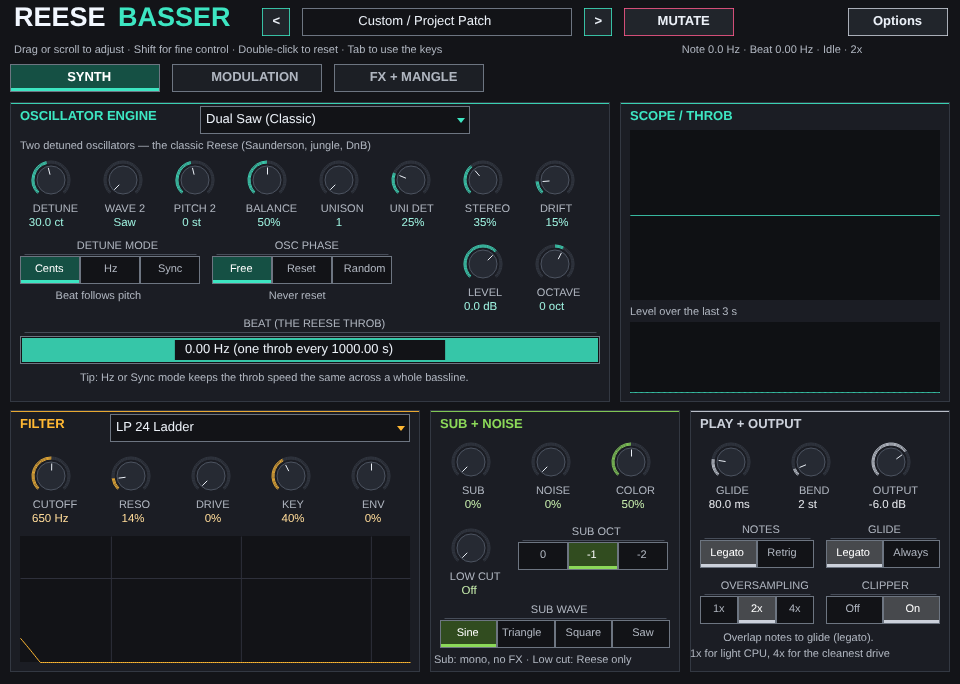

# Reese Basser for Ableton Live

A Max for Live instrument. Its sound is `ReeseBasser.jsfx` translated to gen~, held sample for sample to the JSFX; its window is the JSFX's own.

## Installing

Needs **Live 12.1 or later with Max for Live** (Live Suite, or Standard with
the add-on): the device runs on Max 9's JavaScript engine (`[v8ui]`).

1. Copy `Reese Basser.amxd`, `ReeseBasser.js` and `ReeseBasser.maxpat` into one folder, for
   example `Music/Ableton/User Library/Presets/Instruments/Max Instrument/`. The `.amxd` finds
   `ReeseBasser.js` beside it.
2. Drag `Reese Basser.amxd` onto a MIDI track, as its instrument.
3. Optional: open it in the Max editor and click **Freeze Device**, then save.
   The device then carries the script inside it and can be moved on its own.

## Using it

| | |
| --- | --- |
| **Show Window** | Opens Reese Basser's own window: the eight engines, filter, modulation, effects and presets. Click and drag work as they do in REAPER. |
| The device | Play it from the track's MIDI: notes reach gen~ through a buffer~ the window writes, read by the JSFX's own midirecv loop. |

The patch - every control and preset choice - is saved with the Live set.

## How it is built

`ableton/device.json` describes the device; `python3 ableton/kit/build.py
ableton/device.json` writes the `.amxd`, the `.maxpat` and the script bundle
`ReeseBasser.js`. The bundle is Middaw's EEL2 runtime and `ReeseBasser.jsfx` for the window; the gen~ code inside the device is `ReeseBasser.jsfx` translated by `ableton/kit/jsfx2gen.js` at build time. See `ableton/kit/VENDORED.md`.

`node --test ableton/tests/test_device.js` reads the gen~ code back out of the built device and runs it as JavaScript beside Middaw's runtime running `ReeseBasser.jsfx`: all eight engines played, sample for sample, within 10⁻⁶. It also checks a note played into the device lands in the buffer gen~ reads and sounds, the window draws and answers clicks, every slider reaches gen~, and the patch comes back. `node ableton/kit/test/shot.js ableton/ReeseBasser.js 960 684 out.png` draws the window.

## Limits

- **It has not been opened in Live yet.** It is tested in Node against a stand-in for Max and the Live Object Model; nothing has run in Max. If the `.amxd` will not open, open `ReeseBasser.maxpat` in Max and save it as a device.
- **gen~ has not compiled this code yet.** The tests run the very text in the device as JavaScript and match Middaw's runtime to within 10⁻⁷, but only Max can say gen~ accepts it. If it does not, the Max window names the line; `ableton/kit/jsfx2gen.js` is where to fix it.
- The window's controls are not Live parameters, so they cannot be automated or mapped; they are saved with the set.
- Anything the window draws from the sound itself (a meter, a scope) stays still: the window's copy of the plug-in does not hear the audio.
- Notes reach gen~ at the start of its next 32-sample block, not at their exact sample.
- The VST3/CLAP plug-in on the `plugin` branch also runs in Live, already compiled and tested; this device is the Max for Live alternative.
